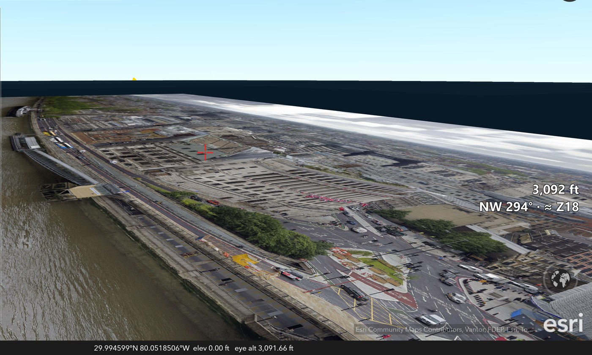
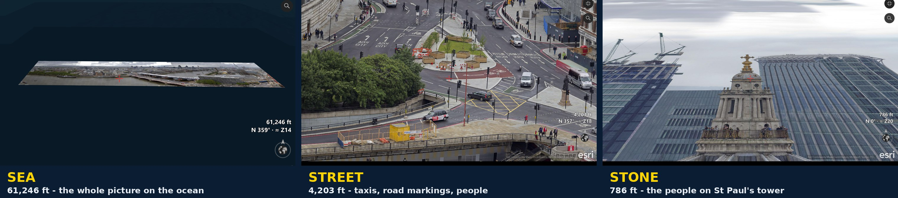

# Rasta Pyramid Factory

**Turn giant pictures into maps you can fly into.** Slice. Dice. Present.

## Get everything you need

**1. ⬇️ [ArcGIS Earth](https://www.esri.com/en-us/arcgis/products/arcgis-earth/downloads)** - free 3D globe from Esri (Windows desktop version), to look at and fly over the result.

**2. ⬇️ [Python 3.14](https://www.python.org/downloads/windows/)** - free; install with the default options.

**3. ⬇️ [QGIS 3.44.9](https://qgis.org/download/)** - free; **only needed for real map rasters** (GeoTIFFs with coordinates). Photos and pictures need no QGIS since v0.2.0 (photo mode).

> **First time? Three quick tips**
> 1. **Extract the zip first:** right-click the downloaded zip > **Extract All**, then open the new folder. Double-clicking files while they are still inside the zip does not work.
> 2. **Windows security warning:** Windows may warn about any program downloaded from the internet. Click **More info > Run anyway** (blue "Windows protected your PC" screen) or **Run**. To avoid the warning, right-click the zip > **Properties** > tick **Unblock** > **OK** before extracting.
> 3. **Installing Python:** if the installer shows **"Add python.exe to PATH"**, tick it.

### **⬇️ [4. DOWNLOAD RASTA PYRAMID FACTORY v0.2.0](releases/Rasta_Pyramid_Factory_v0.2.0.zip)**
**📖 [User manual](docs/USER_MANUAL.md)**
**🗂️ [What's in the zip - every file explained](docs/images/rasta_whats_in_the_zip_full.png)**

Choose a giant picture - a city panorama, a drone map, a scanned map, artwork - press BUILD, and get a zoomable map (TPKX or MBTiles) you can open in ArcGIS Earth: see the whole scene like a hawk, then dive into any detail that catches your eye.



*A London panorama photo (50,000 x 12,006 pixels, 35,216 tiles, built in under 9 minutes) flown in ArcGIS Earth with EarthStick. A photo has no real location, so Rasta parks it on the ocean off Jacksonville and gives it ocean coordinates - the status bar reads 29.99 N, 80.05 W, elevation 0 ft. That simulated georeferencing gives every spot in the picture its own latitude and longitude, so it behaves like a real map: zoom to full detail, put gates, beacons and objects on it, fly through it.*



*Sea, street, stone - one photograph, three heights. From 61,246 ft the whole panorama floats on the ocean like a postcard; at 4,203 ft you read the road markings and the ad on a taxi; at 786 ft you hover beside the bell tower of St Paul's and count the people on its gallery.*

**Fly into your pictures:** with [EarthStick](https://github.com/Jim-dc95811/EarthStick) you fly over the picture like a city; with [World Gate Maker](https://github.com/Jim-dc95811/EarthStick#make-your-own-gates) (ground elev 0) you can put gates that drop you onto any landmark in it.

`Rasta_Pyramid_Factory_v0.1.6.zip` SHA-256: `bf76273ac7fbb462684c5f4a6eac1b1126f6a7ef21d5058ab4284ad642f676a4` - [what changed in v0.1.6](releases/v0.1.6_TEST_RELEASE_NOTES.md)

> **ArcGIS Earth Unlocked:** Rasta is the picture-to-map factory of the broader project family. See the [master system map](https://github.com/Jim-dc95811/ArcGIS-Earth-Unlocked).

---

# Engineering record

### v0.2.0 TEST — PHOTO MODE (2026-11-06) — BUILT / SELF-TESTED

Flat pictures are tiled directly with Pillow - no QGIS. Kings Reach panorama 1: same 35,216 tiles and placement as v0.1.6, about 48 s instead of 8 min 46 s, TPKX 442 MB instead of 1.77 GB. Real map rasters keep the QGIS route. See [v0.2.0 release notes](releases/v0.2.0_TEST_RELEASE_NOTES.md).

## Current version truth

### v0.1.6 — LIVE-PROVEN (2026-11-05) — current release

Jim built `Kings_reach_panorama_1.jpg` (50,000 x 12,006 px, Z0-Z18, 35,216 tiles, 30 bundles, 8:46) and flew it in ArcGIS Earth: PASS. v0.1.5's TPKX fix (mb2tpkx 1.1 structure) plus five fixes from a full code review: the Cancelled message, Cancel stopping QGIS at once, closing the window mid-build (stops QGIS and cleans up first), TPKX max zoom 23 checked before building, typed-in image paths inspected. See [v0.1.6 release notes](releases/v0.1.6_TEST_RELEASE_NOTES.md).

### v0.1.5 TEST — BUILT / SELF-TESTED (2026-11-05)

The TPKX stage now writes the same structure as **mb2tpkx 1.1** (proven in ArcGIS Earth and ArcGIS Pro). Checked against Jim's flown London TPKX: 0 structural differences, all bundles byte-identical. Everything before the TPKX stage is the v0.1.3 LIVE-PROVEN baseline. Waiting for Jim's live test. See [v0.1.5 release notes](releases/v0.1.5_TEST_RELEASE_NOTES.md).

### v0.1.3 TEST — LIVE-PROVEN core

Rasta v0.1.3 remains **LIVE-PROVEN** for:

- automatic flat-image / georaster inspection;
- tiled staging + overviews for giant flat images;
- headless QGIS 3.44.9 pyramid manufacturing;
- verified raster MBTiles;
- deterministic synthetic placement for ordinary flat images;
- long-build heartbeat;
- large/gigapixel workloads;
- TPKX output rendered successfully in **ArcGIS Earth**.

### Important TPKX compatibility boundary — 2026-08-20

A downstream ArcGIS Field Maps control test found a verified defect in the historical MBTiles -> TPKX converter lineage that Rasta v0.1.3 inherited.

Using the same physical-card/Designer workflow, Field Maps:

- rejected a project converter-built TPKX;
- accepted Esri's official `Usa.tpkx`.

Therefore Rasta's TPKX output is **ArcGIS Earth-proven**, but **Field Maps compatibility is not approved**. Since v0.1.6 Rasta writes the same TPKX structure as mb2tpkx 1.1 (ArcGIS Earth and ArcGIS Pro proven); Field Maps has not been tested with it yet.

Rasta's MBTiles manufacturing and giant-raster core are not invalidated by this finding.
---

## Current status

| Capability | Status |
| --- | --- |
| Automated giant-raster processing | ✅ **LIVE-PROVEN** |
| Headless QGIS 3.44.9 pyramid engine | ✅ **LIVE-PROVEN** |
| Raster -> verified MBTiles | ✅ **LIVE-PROVEN** |
| Historical MBTiles -> TPKX -> ArcGIS Earth | ✅ **LIVE-PROVEN** |
| v0.1.6 TPKX stage (mb2tpkx 1.1 structure) -> ArcGIS Earth | ✅ **LIVE-PROVEN 2026-11-05** |
| Historical Rasta TPKX -> Field Maps | ❌ **NOT APPROVED — converter lineage failed Field Maps** |
| v0.1.6 TPKX -> Field Maps | 🟡 **NOT YET TESTED** |
| Gigapixel-class deep navigation | ✅ **LIVE-PROVEN** |
| v0.1.3 synthetic placement + heartbeat | ✅ **LIVE-PROVEN** |
| v0.1.4 TPKX / MBTiles / REST selector | 🟡 **BUILT / SELF-TESTED HISTORICAL TEST BRANCH** |
| REST output | ⏸️ **PARKED** |

---

## Operator workflow

```text
1. Choose giant raster
2. Choose zoom range
3. Choose finished product(s)
4. BUILD RASTER PYRAMID
```

Rasta distinguishes ordinary flat imagery from genuinely georeferenced raster input automatically. The normal operator does not need a CRS-mode selector or manual Georeferencer workflow.

The original source raster is not modified.

---

## Manufacturing architecture

```text
giant source raster
-> QGIS/GDAL inspection
-> real georaster? -> preserve real georeferencing
       |
       no
       v
synthetic display placement
-> tiled working GeoTIFF + overviews
-> QGIS 3.44.9 headless pyramid engine
-> verified raster MBTiles
       |-- preserve MBTiles when selected
       `-- TPKX converter -> TPKX
```

### Current converter rule

For ArcGIS Earth, the v0.1.3 historical TPKX output remains proven evidence.

Since v0.1.6 Rasta's TPKX stage writes the mb2tpkx 1.1 structure (proven in ArcGIS Earth and ArcGIS Pro; byte-identical bundles against Jim's flown London TPKX). Field Maps has not been tested with it - make no Field Maps claim until a real Field Maps test passes.

Do not rewrite the accepted v0.1.3 evidence package and pretend it was always the new converter.

---

## Major live proofs

### Montreal

- 29,684 x 7,620 pixels
- 13,381 raster tiles
- 52 bundles
- Z0-Z18
- 0:05:04
- ArcGIS Earth: PASS

### London — gigapixel-class

`Kings_reach_panorama_2.jpg`

- 63,000 x 18,589 pixels
- approximately 1.17 billion source pixels
- 67,619 final raster tiles
- Z0-Z18
- 30 bundles
- 0:23:07
- Windows File Explorer TPKX size: 1,949,149 KB
- ArcGIS Earth: PASS

Deep navigation resolved individual people inside London Eye observation pods.

### Barcelona

- 62,141 x 14,606 pixels
- approximately 908 million source pixels
- 52,482 final tiles
- Z0-Z18
- 30 bundles
- 0:20:40
- ArcGIS Earth: PASS

### Tower Bridge

- 15,287 x 7,643 pixels
- 6,976 tiles
- Z0-Z18
- 22 bundles
- 0:02:18
- Windows File Explorer TPKX size: 294,910 KB
- ArcGIS Earth: PASS

---

## Source-size lesson

A source file's compressed disk size is a poor predictor of pyramid size. Pixel dimensions, total pixel count, scene complexity, zoom range, and encoding matter more.

---

## Synthetic placement for ordinary images

A normal photograph has no honest geographic location. Rasta labels its placement as **synthetic display space**.

Current reproducible rule:

```text
1 source pixel = 1 projected meter
working CRS = EPSG:3857
fixed synthetic Atlantic anchor near 30°N, 80°W
```

---

## Requirements

- Windows 10/11 64-bit
- Python 3.14.5 64-bit
- QGIS 3.44.9

---

## Deployment boundary

Rasta manufactures raster pyramids. It does not own field-delivery hardware or Field Maps compatibility policy.

Delivering maps to phones and Field Maps happens outside Rasta.

---

## Project family

Rasta Pyramid Factory is part of **[ArcGIS Earth Unlocked](https://github.com/Jim-dc95811/ArcGIS-Earth-Unlocked)** - offline maps, joystick flight ([EarthStick](https://github.com/Jim-dc95811/EarthStick)), World Gates and objects for ArcGIS Earth. Rasta is its picture-to-map factory.

---

## Documentation

- [User manual](docs/USER_MANUAL.md) ([PDF](docs/Rasta_Pyramid_Factory_User_Manual.pdf))
- [Plain-language overview](docs/PLAIN_LANGUAGE_OVERVIEW.md)
- [Operator workflow](docs/OPERATOR_WORKFLOW.md)
- [Technical architecture](docs/TECHNICAL_ARCHITECTURE.md)
- [Live acceptance record](docs/ACCEPTANCE_RECORD.md)
- [Gigapixel + output-size guidance](docs/GIGAPIXEL_AND_OUTPUT_SIZE.md)
- [AI / maintainer restart note](docs/AI_CONTINUITY_RESTART_NOTE.md)
- [Roadmap](ROADMAP.md)
- [Changelog](CHANGELOG.md)

---

## Human-AI engineering collaboration

Rasta Pyramid Factory was conceived, directed and live-tested by **Jim Gaddy**, working with **OpenAI's ChatGPT** and **Anthropic's Claude** as AI coding and documentation partners. Jim supplied the idea of turning giant pictures into navigable pyramids, the QGIS recipe and every live Windows / ArcGIS Earth test. ChatGPT helped build Rasta up to v0.1.4. Claude built v0.1.5-v0.1.6 (the mb2tpkx-structure TPKX stage, the code-review fixes, the structural self-test), the user manual and this page. See [CONTRIBUTORS.md](CONTRIBUTORS.md).

This acknowledgment is not a claim of OpenAI or Anthropic sponsorship or endorsement.

## Governing rule

> **Rasta manufactures the pyramid. The real target decides compatibility. Do not let downstream deployment claims outrun evidence.**
