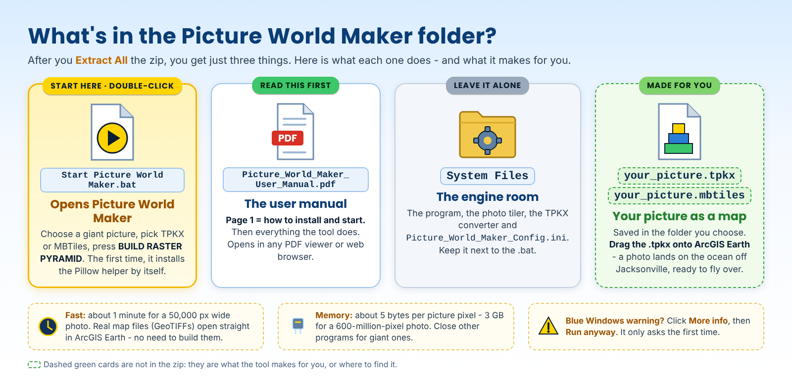
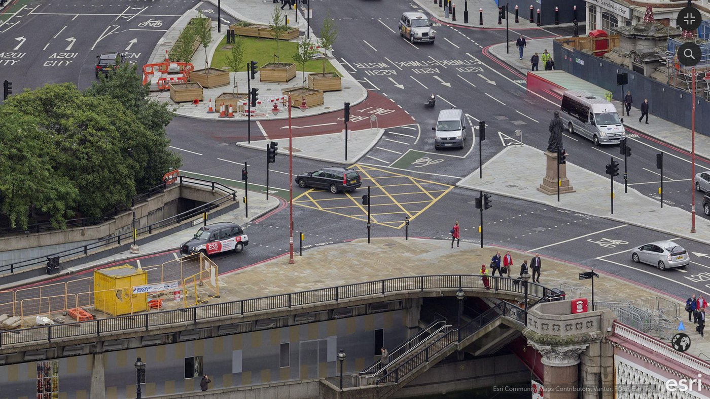
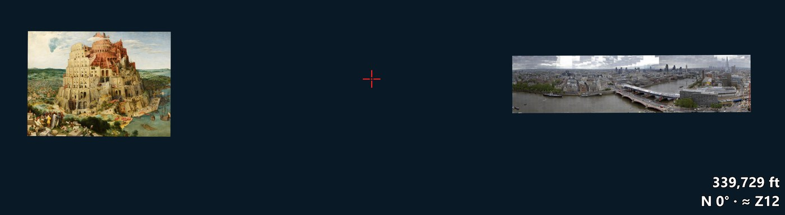

# Picture World Maker v0.2.4 - User Manual

*Formerly Rasta Pyramid Factory.*

Printable copy: [Picture_World_Maker_User_Manual.pdf](Picture_World_Maker_User_Manual.pdf)

**Slice. Dice. Present.** Picture World Maker turns a giant picture - a city panorama, a drone map, a scanned map, artwork - into a zoomable map you can open in **ArcGIS Earth**, then fly over and dive into. *See the whole scene like a hawk. Dive into any detail that catches your eye.*

*A London panorama photo (50,000 x 12,006 pixels) made with Picture World Maker v0.1.6 and flown in ArcGIS Earth. A photo has no real location, so Picture World Maker parks it on the ocean off Jacksonville, Florida: the status bar shows 29.99 N, 80.05 W, elevation 0 ft. Every spot in the picture now has its own latitude and longitude, like a real map.*

## What you need

- **Windows 10 or 11** (64-bit).
- **Python 3** (3.9 or newer) and **Pillow** - free, and `Start Picture World Maker.bat` installs both for you if they are missing (answer **Y**; no admin needed). Or get Python from [python.org](https://www.python.org/downloads/windows/).
- **Pillow** - a free Python picture helper; **Start Picture World Maker.bat installs it by itself** the first time.
- **[ArcGIS Earth](https://www.esri.com/en-us/arcgis/products/arcgis-earth/downloads)** - free, to look at and fly over the result.
- **Memory:** about 5 bytes per picture pixel - about 3 GB for a 600-million-pixel photo, about 6 GB for 1.2 billion.
- **Free disk space on C:** - room for the finished file twice while it builds (the working files go in the Windows temporary folder and are deleted afterwards).

## Install

1. Download [`Picture_World_Maker_v0.2.5.zip`](../releases/Picture_World_Maker_v0.2.5.zip), right-click it > **Extract All**.
2. Open the `Picture_World_Maker_v0.2.5` folder. It holds just two things: **Start Picture World Maker.bat** (the one to double-click) and the **System Files** folder (leave it alone).

## What's in the zip

## Build a picture map

1. Double-click **Start Picture World Maker.bat**.
2. **1. Choose giant raster** - press **CHOOSE IMAGE** and pick your picture (JPG, PNG, TIF, BMP or WEBP). Picture World Maker checks it and shows its size and how many tiles it will make.
3. **2. Pyramid recipe** - leave **Min zoom 0** and **Max zoom 18** for a normal picture. Picture World Maker suggests Max zoom 18: that is where you reach the photo's own detail.
   **World spot** - which spot on the ocean the picture is parked at (1 to 20, see [World spots](#world-spots-a-gallery-on-the-ocean)). Leave it on **1** for a single picture; give each picture of a gallery its own spot.
4. **3. Finished product** - **TPKX** for ArcGIS Earth, **MBTiles** for other map programs, or **Both**. Type a **Name** and choose a **Folder**. The file name gets its World spot added at the end, for example `Tower_of_Babel_spot02.tpkx`.
5. Press **BUILD RASTER PYRAMID** and leave it running. The status line keeps moving - a heartbeat, the time, and the stage (building the pyramid, converting to TPKX, verifying).
6. When it says **RASTER PYRAMID COMPLETE**, your file is in the folder you chose.

How long? About **1 minute** (55 s on Jim's PC) for a 50,000 x 12,006 picture (35,216 tiles, TPKX 442 MB).

**Stopping:** press **CANCEL** - Picture World Maker stops within a second or two, cleans up and says *Build cancelled*. Closing the window with the X does the same before it closes.

## Look at it in ArcGIS Earth

1. Drag the `.tpkx` file onto the ArcGIS Earth map (or use the **+** Add data button).
2. If the view does not jump there, right-click the layer in the list and zoom to it.
3. **Where is it?** A picture has no location, so Picture World Maker places it on the **Atlantic Ocean east of Jacksonville**, centred on its **World spot** (spot 1 = 30 N, 80 W), at **1 picture pixel = 1 map metre**. The ocean is flat and empty, so the picture lies there like a giant carpet.
4. Zoom in: the detail sharpens down to the photo's own pixels.

## World spots: a gallery on the ocean

Since v0.2.4 every picture can have its **own place on the ocean**. Choose a **World spot** in the window before you build. Each spot is the centre of its own one-degree box of open Atlantic east of Florida, about 111,000 x 128,000 picture pixels at 1 pixel per metre, so even very large pictures fit without touching their neighbours. If a picture is bigger than its box, the window says so and asks before building.

- **Spot 1** is where every picture landed before v0.2.4, so your older files stay where they are.
- Spots 2-10 step one degree east along 30 N; spots 11-20 are the row one degree north, at 31 N.
- All 20 spots are open ocean, well clear of the coast, the Bahamas and Bermuda.
- Turn off a picture's layer in ArcGIS Earth when you build a different picture on the same spot - two pictures on one spot lie on top of each other.

*Live-proven 2026-11-06: Bruegel's* Tower of Babel *(public domain, 30,000 x 21,952 px) on World spot 1 and the London panorama on World spot 2 (built in 53 s, 35,205 tiles), side by side on the Atlantic. Jim: "Of all the crazy things to find floating in the Atlantic Ocean!!!"*

**Gates to your pictures:** in World Gate Maker, use a spot's coordinates below with **ground elev 0** to make a gate pair from home to any picture. One gate per picture, each leading to the next, makes a **gallery tour** - an artist's paintings one after another.

| World spot | Latitude | Longitude |
|---|---|---|
| 1 | 30.0 | -80.0 |
| 2 | 30.0 | -79.0 |
| 3 | 30.0 | -78.0 |
| 4 | 30.0 | -77.0 |
| 5 | 30.0 | -76.0 |
| 6 | 30.0 | -75.0 |
| 7 | 30.0 | -74.0 |
| 8 | 30.0 | -73.0 |
| 9 | 30.0 | -72.0 |
| 10 | 30.0 | -71.0 |
| 11 | 31.0 | -80.0 |
| 12 | 31.0 | -79.0 |
| 13 | 31.0 | -78.0 |
| 14 | 31.0 | -77.0 |
| 15 | 31.0 | -76.0 |
| 16 | 31.0 | -75.0 |
| 17 | 31.0 | -74.0 |
| 18 | 31.0 | -73.0 |
| 19 | 31.0 | -72.0 |
| 20 | 31.0 | -71.0 |

## Fly into it with EarthStick

With [EarthStick](https://github.com/Jim-dc95811/EarthStick) you can fly over the picture, hover above any part, and dive in. The readout's **≈ Z** number tells you when you have reached the sharpest detail (about Z18).

*Sea, street, stone - one photograph, three heights: the whole panorama floating on the ocean, the street with its taxis and road markings, and the people on St Paul's bell tower.*

**Gates into your picture:** because every spot of the picture has a latitude and longitude (hover the mouse over it and read the ArcGIS Earth status bar), you can make World Gates that drop you right onto a landmark in the photo. In [World Gate Maker](https://github.com/Jim-dc95811/EarthStick#make-your-own-gates), type those coordinates with **ground elev 0** and a height such as 300 ft.

The picture always lies flat - it is a map layer, so it cannot stand up like a billboard. A photo taken at an angle keeps its own perspective, which gives a strange, half-3D diorama feel when you fly over it.

## Messages and fixes

- **"Not enough memory to open this picture"** - close other programs and try again, or use a smaller picture.
- **Want all-PNG tiles (no JPEG)?** - set `tiles = png` under `[PHOTO]`. Bigger files, no JPEG compression.
- **"has map coordinates"** - the file is a real map (a GeoTIFF). ArcGIS Earth can open it directly: just drag it on. Picture World Maker still builds it, as a picture parked on the ocean.
- **"TPKX supports zoom levels up to 23"** - TPKX (Esri's tile packages) stop at zoom 23. Lower Max zoom, or choose MBTiles only (up to 25).
- **"Output already exists"** - pick another Name or move the old file.
- **It runs for a long time** - giant pictures take minutes; the moving heartbeat shows it is working. The size warning before the build tells you how many tiles to expect.
- **The disk fills up** - free space on C: (room for the finished file twice while building).

## What Picture World Maker does not do

- It cannot add detail that is not in the photo - a blurry photo stays blurry when you zoom in.
- A photo parked on the ocean is not real geography; its location is a display spot, chosen so the map tools can work.
- The original picture is never changed.
