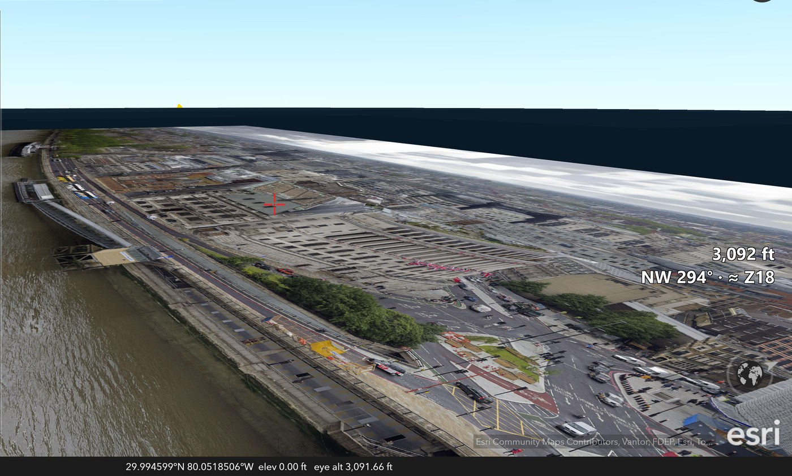
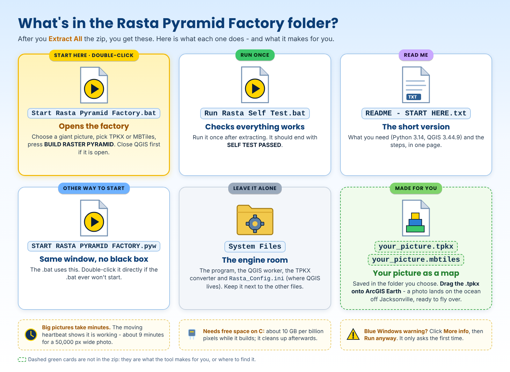
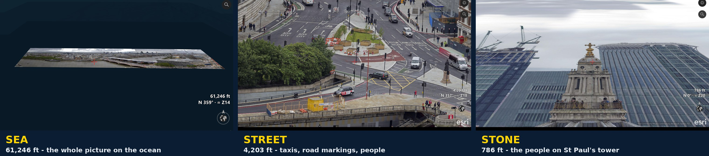

# Rasta Pyramid Factory v0.2.0 - User Manual

Printable copy: [Rasta_Pyramid_Factory_User_Manual.pdf](Rasta_Pyramid_Factory_User_Manual.pdf)

**Slice. Dice. Present.** Rasta Pyramid Factory turns a giant picture - a city panorama, a drone map, a scanned map, artwork - into a zoomable map you can open in **ArcGIS Earth**, then fly over and dive into. *See the whole scene like a hawk. Dive into any detail that catches your eye.*

*A London panorama photo (50,000 x 12,006 pixels) made with Rasta v0.1.6 and flown in ArcGIS Earth. A photo has no real location, so Rasta parks it on the ocean off Jacksonville, Florida: the status bar shows 29.99 N, 80.05 W, elevation 0 ft. Every spot in the picture now has its own latitude and longitude, like a real map.*

## What you need

- **Windows 10 or 11** (64-bit).
- **[Python 3.14](https://www.python.org/downloads/windows/)** - free; tick "Add python.exe to PATH" if the installer shows it.
- **[QGIS 3.44.9](https://qgis.org/download/)** - free; **only for real map rasters** (GeoTIFFs with coordinates), installed at the normal place, `C:\Program Files\QGIS 3.44.9`. Rasta uses it behind the scenes. **Photos and other flat pictures do not need QGIS** (photo mode, v0.2.0).
- **Pillow** - a free Python helper for photo mode; **Start Rasta Pyramid Factory.bat installs it by itself** the first time.
- **[ArcGIS Earth](https://www.esri.com/en-us/arcgis/products/arcgis-earth/downloads)** - free, to look at and fly over the result.
- **Memory for photo mode:** about 5 bytes per picture pixel - about 3 GB for a 600-million-pixel photo, about 6 GB for 1.2 billion.
- **Free disk space on C:** - room for the finished file twice while it builds (the working files go in the Windows temporary folder and are deleted afterwards).

## Install

1. Download [`Rasta_Pyramid_Factory_v0.2.0.zip`](../releases/Rasta_Pyramid_Factory_v0.2.0.zip), right-click it > **Extract All**.
2. Open the `Rasta_Pyramid_Factory_v0.2.0` folder and double-click **Run Rasta Self Test.bat** once. It should end with **SELF TEST PASSED**.

## What's in the zip

## Build a picture map

1. For a **real map raster** (QGIS route): **close QGIS** if you have it open. Photos do not care.
2. Double-click **Start Rasta Pyramid Factory.bat**.
3. **1. Choose giant raster** - press **CHOOSE IMAGE** and pick your picture (JPG, PNG, TIF, BMP or WEBP). Rasta checks it and shows its size, whether it is a flat picture or a real map, and how many tiles it will make.
4. **2. Pyramid recipe** - leave **Min zoom 0** and **Max zoom 18** for a normal picture. Rasta suggests Max zoom 18 for flat pictures: that is where you reach the photo's own detail. The green line shows how it will be built: **PHOTO MODE - no QGIS needed** for pictures, **QGIS 3.44.9** for real map rasters.
5. **3. Finished product** - **TPKX** for ArcGIS Earth, **MBTiles** for other map programs, or **Both**. Type a **Name** and choose a **Folder**.
6. Press **BUILD RASTER PYRAMID** and leave it running. The status line keeps moving - a heartbeat, the time, and the stage (photo-mode pyramid or QGIS pyramid, converting to TPKX, verifying).
7. When it says **RASTER PYRAMID COMPLETE**, your file is in the folder you chose.

How long? In **photo mode** about **1 minute** for a 50,000 x 12,006 picture (35,216 tiles), and the TPKX is about a quarter of the size the QGIS route makes (442 MB instead of 1.77 GB for that picture). The QGIS route took 9 minutes for the same picture on Jim's PC.

**Stopping:** press **CANCEL** - Rasta stops within a second or two, cleans up and says *Build cancelled*. Closing the window with the X does the same before it closes.

## Look at it in ArcGIS Earth

1. Drag the `.tpkx` file onto the ArcGIS Earth map (or use the **+** Add data button).
2. If the view does not jump there, right-click the layer in the list and zoom to it.
3. **Where is it?** A real map (a GeoTIFF with coordinates) lands where it belongs. An ordinary **photo** has no location, so Rasta places it on the **Atlantic Ocean at about 30 N, 80 W**, east of Jacksonville, at **1 picture pixel = 1 map metre**. The ocean is flat and empty, so the picture lies there like a giant carpet.
4. Zoom in: the detail sharpens down to the photo's own pixels.

## Fly into it with EarthStick

With [EarthStick](https://github.com/Jim-dc95811/EarthStick) you can fly over the picture, hover above any part, and dive in. The readout's **≈ Z** number tells you when you have reached the sharpest detail (about Z18).

*Sea, street, stone - one photograph, three heights: the whole panorama floating on the ocean, the street with its taxis and road markings, and the people on St Paul's bell tower.*

**Gates into your picture:** because every spot of the picture has a latitude and longitude (hover the mouse over it and read the ArcGIS Earth status bar), you can make World Gates that drop you right onto a landmark in the photo. In [World Gate Maker](https://github.com/Jim-dc95811/EarthStick#make-your-own-gates), type those coordinates with **ground elev 0** and a height such as 300 ft.

The picture always lies flat - it is a map layer, so it cannot stand up like a billboard. A photo taken at an angle keeps its own perspective, which gives a strange, half-3D diorama feel when you fly over it.

## Messages and fixes

- **"QGIS Desktop is running"** (real map rasters only) - close QGIS, then build again.
- **"Not enough memory to open this picture in photo mode"** - close other programs, or set `engine = qgis` under `[PHOTO]` in `System Files\Rasta_Config.ini` to use the QGIS route.
- **Want all-PNG tiles (no JPEG)?** - set `tiles = png` under `[PHOTO]`. Bigger files, no JPEG compression.
- **"QGIS install folder not found" / "expects QGIS 3.44.9"** (real map rasters) - install QGIS 3.44.9 at the normal place, or put your QGIS folder in `System Files\Rasta_Config.ini` (`qgis_install_dir`).
- **"TPKX supports zoom levels up to 23"** - TPKX (Esri's tile packages) stop at zoom 23. Lower Max zoom, or choose MBTiles only (up to 25).
- **"Output already exists"** - pick another Name or move the old file.
- **It runs for a long time** - giant pictures take minutes; the moving heartbeat shows it is working. The size warning before the build tells you how many tiles to expect.
- **The disk fills up** - free space on C: (room for the finished file twice while building).

## What Rasta does not do

- It cannot add detail that is not in the photo - a blurry photo stays blurry when you zoom in.
- A photo parked on the ocean is not real geography; its location is a display spot, chosen so the map tools can work.
- The original picture is never changed.

## Self-test

Double-click **Run Rasta Self Test.bat** (or `py -3.14 "System Files\RPF_SELF_TEST.py"`). It checks the placement maths, the zoom rules and the TPKX converter (it converts a small test map and checks the result against the ArcGIS Earth-proven structure).
